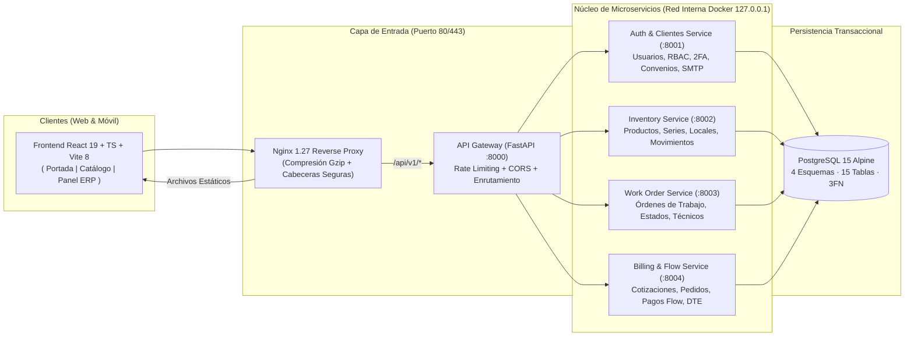

# Resumen Ejecutivo de Presentación de Proyecto — Plataforma Integral MARCOM

**Organización:** Sociedad de Instalaciones Marcom Compañía Limitada (`marcomchile.cl`)  
**Enfoque del Documento:** Dirección de Proyecto (*Project Management*), Arquitectura, Modelo de Datos, Seguridad y Aseguramiento de Calidad (QA)  
**Estado del Proyecto:** En Producción (Contenerizado con Docker y sincronizado en GitHub)

---

## 1. Visión Ejecutiva y Caso de Negocio

Como Jefe de Proyecto, la presentación debe iniciar conectando la **problemática operativa real** de **Marcom** con la solución tecnológica construida:

- **Contexto Operativo:** Marcom lidera el despliegue, montaje y mantenimiento de infraestructura digital (cartelería digital, *menú boards*, sistemas POS, pantallas de placa y redes de datos) para grandes cadenas de retail y servicentros a nivel nacional (destacando convenios estratégicos como **Copec S.A.** y **Arcoprime / Pronto**).
- **Problema que resuelve la plataforma:** Centraliza en un único ecosistema digital procesos que tradicionalmente operaban de forma fragmentada:
  1. **Trazabilidad de Bodega a Terreno:** Control exacto de números de serie, activos asignados a técnicos y ubicaciones instaladas por estación o tienda.
  2. **Gestión de Órdenes de Trabajo (OT) y SLA:** Asignación, ejecución en terreno con evidencia y cierre técnico.
  3. **Control Financiero de Convenios y Cotizaciones (OC):** Seguimiento en tiempo real de límites de crédito corporativo, cotizaciones formales y facturación DTE.
  4. **Nuevo Canal Comercial B2B/B2C (Catálogo E-Commerce):** Venta directa en línea de monitores profesionales con pasarela de pago **Flow**, cálculo automático de IVA/UF y libro de ventas exportable a CSV.

> **Mensaje clave para el directorio / comité evaluador:** La plataforma no es solo un sitio web informativo; es un **ERP operativo de campo + Portal B2B de Convenios + E-Commerce transaccional** diseñado bajo arquitectura empresarial de microservicios.

---

## 2. Arquitectura Tecnológica (Microservicios y Contenedores)

El sistema fue diseñado siguiendo el patrón de **Microservicios desacoplados con API Gateway y Proxy Inverso**, garantizando escalabilidad, aislamiento de fallos y facilidad de despliegue en servidores Linux de producción.

---

## 3. Modelo de Datos, Normalización y Funcionamiento de la Base de Datos

El motor de persistencia es **PostgreSQL 15 Alpine**, definido íntegramente en `database/init.sql` y mapeado mediante **SQLAlchemy ORM** en cada microservicio.

### 3.1. Métricas Generales del Modelo de Datos
- **4 Esquemas Lógicos por Dominio (*Schema-per-Microservice*):** Aísla las responsabilidades de cada microservicio manteniendo integridad referencial ACID entre dominios.
- **15 Tablas Relacionales en total:** Distribuidas estratégicamente en los 4 esquemas (`3 + 4 + 3 + 5 = 15 tablas`).
- **6 Tipos Enumerados (`ENUM`) Nativos:** Validan estados de negocio directamente a nivel de motor de base de datos (`rol_usuario`, `estado_activo_enum`, `estado_ot_enum`, `metodo_pago_enum`, `estado_pago_enum`, `tipo_dte_enum`).
- **18 Índices B-Tree (`CREATE INDEX`):** Optimizan las búsquedas frecuentes por número de serie, código de local, región, zona, estado de OT, técnico asignado y convenio.
- **Claves Primarias Subrogadas `UUID v4` (`uuid-ossp`):** Todas las 15 tablas utilizan identificadores `UUID` generados por el motor (`uuid_generate_v4()`), impidiendo ataques de enumeración secuencial de IDs (`IDOR`) y permitiendo generación distribuida sin colisiones.

### 3.2. Detalle Completo de las 15 Tablas por Esquema

| Esquema (Dominio) | Cant. | Tablas Principales | Función Operativa y Claves Relevantes |
| :--- | :---: | :--- | :--- |
| **`esquema_auth_clientes`** | **3** | 1. `usuarios` 2. `convenios` 3. `perfiles_clientes` | • **`usuarios`**: Credenciales (`clave_hash` Bcrypt), `rut` (`UNIQUE`), `correo` (`UNIQUE`), `rol` (`ENUM`), seguridad 2FA (`mfa_secreto`, `mfa_codigos_respaldo`) y bloqueo anti-fuerza bruta (`intentos_fallidos`, `bloqueado_hasta`). • **`convenios`**: Empresas en contrato (ej. Copec, Arcoprime), `rut` (`UNIQUE`), `limite_credito` y `credito_usado` (`NUMERIC(12,2)`). • **`perfiles_clientes`**: Relación `1:1` con `usuarios` y `N:1` con `convenios`, almacenando teléfono, dirección, región y comuna. |
| **`esquema_inventario`** | **4** | 4. `ubicaciones` 5. `catalogo_productos` 6. `activos` 7. `movimientos_stock` | • **`ubicaciones`**: Modela tanto la Bodega Central (`es_bodega = TRUE`) como los locales/estaciones de clientes (`codigo_local UNIQUE`, región, comuna, tarifas en UF de instalación/transporte y datos del encargado). • **`catalogo_productos`**: Maestro de modelos de hardware (`sku UNIQUE`, nombre, marca, categoría, pulgadas). • **`activos`**: Unidades físicas individualizadas por `numero_serie UNIQUE` y `codigo_qr UNIQUE`, vinculadas a un `producto_id` y a su `ubicacion_actual_id`. • **`movimientos_stock`**: Bitácora histórica inmutable (*Kardex*) que registra cada traslado entre `ubicacion_origen_id` y `ubicacion_destino_id`, quién lo autorizó (`usuario_movimiento_id`) y el motivo. |
| **`esquema_ordenes_trabajo`** | **3** | 8. `ordenes_trabajo` 9. `activos_orden_trabajo` 10. `evidencias_terreno` | • **`ordenes_trabajo`**: Cabecera de la OT (`numero_orden UNIQUE`, `convenio_cliente_id`, `ubicacion_id`, `tecnico_asignado_id`, `estado` ENUM y fechas programada/término). • **`activos_orden_trabajo`**: Tabla asociativa que registra qué activo se instaló (`activo_instalado_id`) y/o cuál se retiró por falla (`activo_retirado_id`) durante la OT. • **`evidencias_terreno`**: Respaldo fotográfico (`url_imagen`), firma digital de recepción (`url_firma`) y comentarios técnicos en terreno. |
| **`esquema_facturacion`** | **5** | 11. `pedidos` 12. `pagos` 13. `documentos_dte` 14. `cotizaciones` 15. `cotizaciones_items` | • **`pedidos`**: Orden de compra generada desde el Catálogo o desde un Convenio (`monto_total`, `metodo_pago`, `estado_pago`). • **`pagos`**: Transacciones procesadas por **Flow** (`transaccion_pasarela_id`, `monto`, `estado` y `payload_respuesta JSONB`). • **`documentos_dte`**: Registro tributario (`FACTURA_ELECTRONICA`, `BOLETA_ELECTRONICA`, `GUIA_DESPACHO`, `folio_sii`, XML/PDF). • **`cotizaciones`**: Presupuesto formal (`numero_cotizacion UNIQUE`), costos de soporte, kilometraje, instalación, neto, IVA 19%, total y vínculo con OC, OT y Pedido. • **`cotizaciones_items`**: Detalle línea por línea de productos cotizados (`producto_id`, `cantidad`, `precio_unitario`, `subtotal`). |

### 3.3. Nivel de Normalización (3FN) y Decisiones de Diseño Relacional

El modelo de datos cumple rigurosamente hasta la **Tercera Forma Normal (3FN)**, combinada con capacidades híbridas modernas de PostgreSQL:

1. **Primera Forma Normal (1FN — Atomicidad y Eliminación de Grupos Repetitivos):**
   - Cada columna almacena un único valor atómico.
   - En lugar de guardar múltiples productos dentro de una columna de texto en `cotizaciones` o múltiples series en `ordenes_trabajo`, se desacoplaron las tablas detalle `cotizaciones_items` (`1:N`) y `activos_orden_trabajo` (`1:N`).
2. **Segunda Forma Normal (2FN — Dependencia Funcional Completa de la Clave Primaria):**
   - Todas las tablas cuentan con una clave primaria simple e inmutable (`UUID v4`), además de restricciones `UNIQUE` sobre las claves naturales del negocio (`rut`, `correo`, `sku`, `numero_serie`, `codigo_local`, `numero_orden`, `numero_cotizacion`).
   - En las tablas de detalle (`cotizaciones_items`, `activos_orden_trabajo`), todos los atributos dependen completamente de la clave de la línea y no parcialmente de la cabecera.
3. **Tercera Forma Normal (3FN — Eliminación de Dependencias Transitivas):**
   - **Separación Catálogo vs. Activo Físico:** Los atributos descriptivos del monitor (`marca`, `nombre`, `pulgadas`, `categoria`) viven únicamente en `catalogo_productos`, mientras que `activos` solo almacena los datos propios de la unidad física (`numero_serie`, `estado_actual`, `ubicacion_actual_id`). Así, si se actualiza la descripción de un modelo, no se actualizan cientos de filas de números de serie.
   - **Separación Identidad vs. Perfil Comercial:** La tabla `usuarios` contiene únicamente atributos de autenticación y seguridad (hash, rol, MFA, bloqueo), delegando los datos de contacto y convenio a `perfiles_clientes` y `convenios`.
   - **Separación Estado Actual vs. Historial de Movimientos:** El estado presente del equipo está en `activos`, mientras que toda la trazabilidad histórica se registra en `movimientos_stock` sin redundancia.
4. **Precisión Financiera y Auditoría Híbrida (`NUMERIC` + `JSONB`):**
   - Todos los montos monetarios y de crédito utilizan `NUMERIC(12, 2)` (aritmética decimal exacta, evitando errores de redondeo de punto flotante `FLOAT`).
   - En la tabla `pagos`, se utiliza una columna `JSONB` (`payload_respuesta`) exclusivamente para resguardar de forma inmutable el comprobante técnico devuelto por la pasarela **Flow**, manteniendo el resto del esquema 100% relacional en 3FN.
5. **Políticas de Integridad Referencial (`ON DELETE`):**
   - **`ON DELETE CASCADE`:** En tablas dependientes débiles (`perfiles_clientes`, `cotizaciones_items`, `activos_orden_trabajo`, `evidencias_terreno`).
   - **`ON DELETE RESTRICT`:** En `catalogo_productos` y `ubicaciones` referenciadas por cotizaciones o activos, impidiendo borrar accidentalmente un local o producto con historial operativo.
   - **`ON DELETE SET NULL`:** En relaciones opcionales (`tecnico_asignado_id`, `convenio_id`) para conservar la historia de la OT o del usuario aunque cambie la estructura organizacional.

---

## 4. Alcance Funcional por Módulo

| Módulo | Archivos Clave | Valor de Negocio Entregado |
| :--- | :--- | :--- |
| **1. Portada Corporativa y Galería** | `frontend/src/pages/Portada.tsx` | Presentación B2B de servicios, carrusel fotográfico real de instalaciones en terreno con visor *Lightbox* y acceso directo a contacto y catálogo. |
| **2. Catálogo y E-Commerce (Flow)** | `frontend/src/pages/Catalog.tsx` | Filtros dinámicos (pulgadas, resolución, nits, operación 24/7), selección de soporte VESA, carrito de compras, checkout con validación tributaria (Boleta/Factura) e integración con **Flow**. |
| **3. Dashboard Ejecutivo y Mapa** | `frontend/src/pages/Dashboard.tsx` | Indicadores económicos en vivo (UF, Dólar, UTM, Euro, IPC), clima por estación en terreno, métricas de OTs y mapa interactivo de cobertura nacional. |
| **4. Convenios y Cotizaciones** | `frontend/src/pages/Agreements.tsx`, `frontend/src/pages/Quotations.tsx` | Gestión de líneas de crédito corporativo (disponible vs. utilizado) y generación/impresión de cotizaciones formales. |
| **5. Inventario y Activos Seriados** | `frontend/src/pages/Inventory.tsx` | Control de stock en bodega central, asignación de hardware a técnicos y trazabilidad por número de serie y local de cliente. |
| **6. Órdenes de Trabajo (OT)** | `frontend/src/pages/WorkOrders.tsx` | Flujo completo de atención en terreno: creación de solicitud, asignación de técnico, seguimiento de estado y cierre operativo. |
| **7. Control de Ventas y Facturación** | `frontend/src/pages/SalesControl.tsx`, `frontend/src/pages/Facturacion.tsx` | Conciliación de pagos aprobados, desglose automático de montos (Neto, IVA 19%, Bruto, UF) y exportación del **Libro de Ventas en CSV** para contabilidad. |

---

## 5. Arquitectura de Seguridad Integral (7 Capas Defensivas)

- **Capa 1 · Hashing Bcrypt y Política Alfanumérica + Carácter Especial:** Mínimo 8 caracteres exigiendo mayúsculas, minúsculas, números y símbolos (`!@#$%^&*._-`).
- **Capa 2 · Recuperación SMTP con Clave Temporal (`contacto@marcomchile.cl`):** Envío por SSL (`puerto 465`) de contraseña temporal aleatoria y cambio obligatorio al iniciar sesión.
- **Capa 3 · Doble Factor (2FA TOTP) y Bloqueo Anti-Fuerza Bruta:** Código QR compatible con Google Authenticator y bloqueo temporal tras 5 intentos fallidos.
- **Capa 4 · Control de Acceso Basado en Roles (RBAC):** Tokens JWT (`HS256`) para 5 roles (`ADMIN`, `JEFE_BODEGA`, `TECNICO_TERRENO`, `CLIENTE_CONVENIO`, `CLIENTE_ESTANDAR`).
- **Capa 5 · Aislamiento Perimetral Docker y Rate Limiting:** Puertos internos atados a `127.0.0.1`, límite de peticiones en Gateway y cabeceras seguras en Nginx.
- **Capa 6 · Integridad de RUT Chileno:** Sanitización y validación estricta sin puntos y con guion (`12345678-9`) en cliente y servidor.
- **Capa 7 · Auditoría de Dependencias:** `npm audit` con **0 vulnerabilidades** (`vite 8.3.4`).

---

## 6. Plan de Pruebas y Aseguramiento de Calidad (QA) Realizado

| Categoría de Prueba | Casos de Prueba Ejecutados | Resultado |
| :--- | :--- | :--- |
| **Seguridad y Acceso** | Login por rol RBAC, bloqueo tras 5 intentos fallidos, enrolamiento 2FA TOTP y rechazo de claves débiles. | **Aprobado** |
| **Recuperación de Clave (SMTP)** | Recepción real desde `contacto@marcomchile.cl` con contraseña temporal y cambio obligatorio al ingresar. | **Aprobado** |
| **Validación de Formularios (RUT)** | Eliminación automática de puntos y exigencia de formato `XXXXXXX-X` / `XXXXXXXX-X`. | **Aprobado** |
| **Modelo de Datos e Integridad** | Despliegue de 4 esquemas, 15 tablas, 6 ENUMs, 18 índices y reglas referenciales (`CASCADE`, `RESTRICT`, `SET NULL`). | **Aprobado** |
| **Flujo Comercial y Facturación** | Carrito con soporte VESA, checkout Boleta/Factura, conciliación Neto/IVA/UF y descarga de Libro CSV. | **Aprobado** |
| **Responsividad y UX/UI** | Pruebas en móviles (`360px–430px`), modos Claro/Oscuro y limpieza visual de tarjetas y cabeceras. | **Aprobado** |
| **Infraestructura y Seguridad** | `npm audit` (**0 vulnerabilidades**), compilación TypeScript limpia y 7 contenedores Docker activos. | **Aprobado** |
